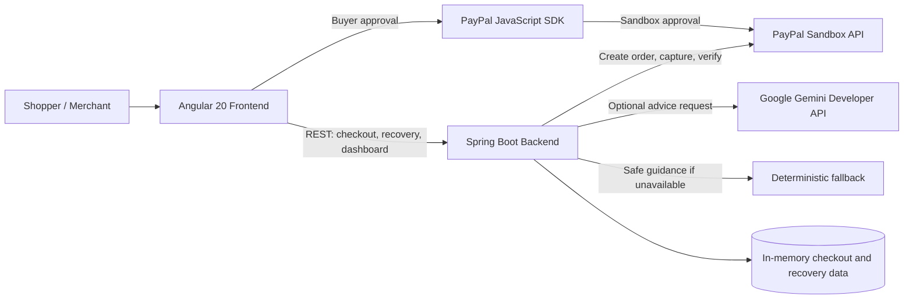

# CartBridge AI

**A safer way to recover when checkout gets confusing.**

Checkout can fail at the worst moment: a page stalls, a payment appears to hang, or the shopper cannot tell whether it is safe to try again. That uncertainty can lead to abandoned purchases—or accidental duplicate attempts.

CartBridge AI is a local hackathon demo that helps shoppers describe a checkout problem, receive a plain-language explanation and a safe next step, and complete a PayPal **Sandbox** checkout. The backend—not AI—owns checkout state and verifies payment outcomes with PayPal before it reports a payment as complete.

## What it does

- Browse a small demo catalogue and create a checkout.
- Approve a payment with the PayPal JavaScript SDK in Sandbox.
- Create orders, capture only after buyer approval, and verify order/capture IDs, status, amount, and currency through PayPal's REST API.
- Ask for recovery advice based on the shopper's description and server-sourced checkout context.
- Use the configured Gemini model when available; return clearly labeled `FALLBACK` guidance if Gemini is unavailable or not configured.
- Give deterministic no-retry guidance for payment states that require verification.
- Review current-process checkout and recovery records in a merchant dashboard.

## Architecture



## AI recovery and payment safety

1. The backend loads the checkout session and uses its product, amount, currency, and payment status; it does not trust client-supplied payment outcomes.
2. `COMPLETED` sessions are described as paid only after backend verification. `APPROVED` and `PENDING` sessions are told to wait for verification, not retry.
3. For other states, the backend requests structured advice from Gemini if a key is configured. If Gemini is missing, times out, is unavailable, or returns invalid/unsafe advice, the backend supplies deterministic `FALLBACK` guidance.
4. Advice is not a payment operation. It cannot create, approve, capture, cancel, or verify a PayPal payment.

The backend creates PayPal orders and captures only after buyer approval. It verifies PayPal's returned order/capture IDs, status, amount, and currency and uses PayPal request IDs for idempotency. The browser never receives the PayPal Client Secret or Gemini key.

## Screenshots

Add genuine screenshots captured from the running local app under `docs/screenshots/`, then replace these placeholders. Do not commit credentials, buyer information, or other sensitive data in screenshots.

<!-- Replace with a real storefront screenshot at docs/screenshots/storefront.png. -->


<!-- Replace with a real merchant dashboard screenshot at docs/screenshots/merchant-dashboard.png. -->


## Technology

- **Frontend:** Angular 20, TypeScript, SCSS
- **Backend:** Java 17, Spring Boot 3.5.6, Maven
- **Payments:** PayPal JavaScript SDK and REST Orders API, Sandbox only
- **Recovery AI:** Google Gemini Developer API through the Google GenAI Java SDK; optional
- **Storage:** In-memory checkout sessions and recovery history

## Requirements

- Java 17
- Maven 3.9+
- Node.js 20.19+ or 22.12+ (Node.js 24 is also supported by the installed Angular CLI)
- npm
- PayPal Developer Sandbox REST app credentials and a Sandbox personal/buyer account

## Configure local backend credentials

The root `.env.example` is the single placeholder-only template for backend settings. Spring Boot loads `backend/.env` as a Java properties file when starting from the `backend` directory. The `.env` file is ignored by Git. Never copy credentials into Angular files, source control, or logs.

In PowerShell, create the ignored local file and open it in a text editor:

```powershell
Set-Location 'C:\Users\Admin\Desktop\CartBridge AI\backend'
Copy-Item '..\.env.example' '.env'
notepad .env
```

In Notepad, replace the PayPal placeholders with your **PayPal Sandbox REST app** Client ID and Secret. Keep `PAYPAL_BASE_URL=https://api-m.sandbox.paypal.com`; production PayPal URLs are not supported. Set `PAYPAL_CURRENCY=USD` for the demo. To use Gemini, add a Google AI Studio key to `GOOGLE_API_KEY`. Gemini is optional: leave it blank to use safe `FALLBACK` recovery guidance. `GEMINI_MODEL` defaults to `gemini-3.8-flash`.

Save `backend/.env`. Do not paste credentials into PowerShell commands or commit this file. `.env.example` contains placeholders only. Spring Boot's optional config import means the backend also starts if `.env` is absent; without PayPal credentials, PayPal checkout reports its normal configuration error.

## Run locally

Start the backend from the `backend` directory so the local `.env` file is found:

```powershell
Set-Location 'C:\Users\Admin\Desktop\CartBridge AI\backend'
mvn spring-boot:run
```

In a second PowerShell terminal, start Angular:

```powershell
Set-Location 'C:\Users\Admin\Desktop\CartBridge AI\frontend'
npm start
```

Open [http://localhost:4200](http://localhost:4200). The backend listens on port 8080.

The Angular app does not load or contain backend secrets. Only the public PayPal Client ID is provided to the browser for the PayPal JavaScript SDK; PayPal Client Secret and Gemini key remain backend-only.

### Try a Sandbox payment

1. Sign in to the PayPal Developer Dashboard and create or select a Sandbox personal account to act as the buyer.
2. Open the local storefront, choose a product and quantity, and click the PayPal button.
3. Approve using the Sandbox buyer account, not a personal PayPal account.
4. The frontend sends the approved order ID and checkout-session ID to the backend. The backend fetches and verifies the order, captures it, and validates PayPal's capture response before displaying `COMPLETED`.
5. To test cancellation, close or cancel the PayPal approval flow. Pending or declined outcomes are not described as completed payments.

> **Sandbox only:** The backend accepts only `https://api-m.sandbox.paypal.com`. Do not use production credentials or real payment details. The backend does not accept a client-supplied total or success status.

## API overview

- `GET /api/health` — health status.
- `GET /api/products` — demo catalogue.
- `GET /api/paypal/config` — public PayPal Client ID and currency; without both server-side PayPal credentials, returns HTTP 503.
- `POST /api/checkout-sessions` — create a checkout session from a server-side catalogue product.
- `POST /api/paypal/orders` — create a Sandbox order on the backend.
- `POST /api/paypal/capture` — capture after buyer approval and verify the result server-side.
- `POST /api/paypal/cancel` — record cancellation according to backend payment state.
- `POST /api/recovery/advice` — request Gemini or fallback recovery advice.
- `GET /api/merchant/dashboard` — current in-memory checkout summary and checkout details.
- `GET /api/merchant/recovery-history` — current in-memory recovery records.

`POST /api/recovery/advice` accepts the backend checkout-session ID and problem description:

```json
{
  "checkoutSessionId": "49b5c470-f1d0-41d9-b9fc-29873c79ec81",
  "problemDescription": "The checkout page stopped responding after I selected PayPal."
}
```

Example response shape (advice text and source depend on the session and provider availability):

```json
{
  "detectedIssue": "Checkout page may have stalled",
  "explanation": "The page may not have finished loading the payment step.",
  "recommendedNextAction": "Wait and check checkout status before trying again.",
  "safetyWarning": "Do not share payment credentials or sensitive payment details.",
  "adviceSource": "GEMINI"
}
```

`adviceSource` is `GEMINI` for accepted generated advice and `FALLBACK` for server-provided guidance. The backend itself supplies no-retry guidance for `APPROVED`, `PENDING`, and `COMPLETED` sessions.

## Tests and production builds

```powershell
Set-Location 'C:\Users\Admin\Desktop\CartBridge AI\backend'
mvn test
mvn clean package

Set-Location 'C:\Users\Admin\Desktop\CartBridge AI\frontend'
npm test -- --watch=false
npm run build
```

Backend PayPal tests use mocked HTTP responses and do not require live credentials.

## Known limitations and future improvements

- **In-memory storage:** Checkout sessions and recovery history disappear when the backend restarts; the dashboard only reflects records in the current process.
- **No merchant authentication:** Dashboard endpoints are unauthenticated. This is a local demo; do not expose it to the public internet.
- **External service availability:** Gemini is optional and may be unavailable; in that case, the backend returns fallback guidance. PayPal Sandbox is required for the payment demonstration.
- **Demo scope:** The sample storefront and catalogue are not a production commerce system.

Possible next steps include durable persistence, merchant authentication and authorization, and deployment hardening before any public hosting.

## AI tools and third-party services

- **Google Gemini Developer API:** Optional runtime provider for checkout recovery advice. The configured model is selected by `GEMINI_MODEL` (default `gemini-3.8-flash`). Advice is treated as untrusted; backend validation and deterministic fallback guidance remain authoritative.
- **PayPal Sandbox:** Provides buyer approval and payment API operations for test transactions only. This project does not support real-money processing.
- **Google GenAI Java SDK, Angular, and Spring Boot:** Third-party libraries/frameworks used by the application; see the dependency manifests for versions.
